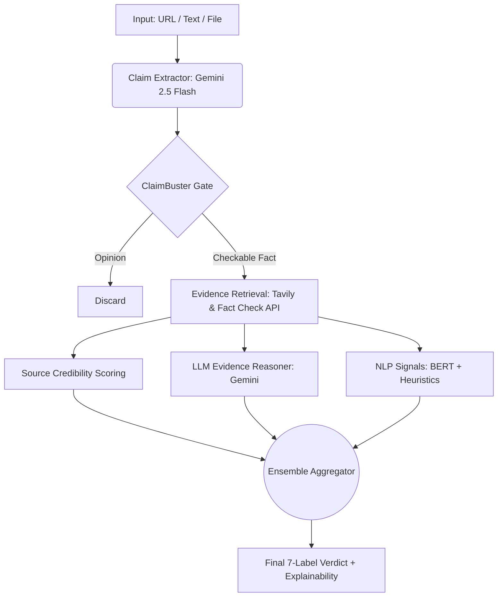

# 🔍 VeritasAI
> **"See Through the Noise"** — A full-stack AI-powered misinformation verification platform that breaks down articles into atomic, checkable claims, retrieves real-time evidence, and delivers a credibility-weighted ensemble verdict with full explainability.

[](https://github.com/AtharvS7/VeritasAI-v2/actions/workflows/ci.yml)
[](https://opensource.org/licenses/MIT)
[](https://www.python.org/)
[](https://react.dev/)
[](https://fastapi.tiangolo.com/)

**[🔴 Live Demo](https://veritas-ai-delta.vercel.app/)**

---

## 📋 Table of Contents

- [What is VeritasAI?](#-what-is-veritasai)
- [Verification Pipeline](#-verification-pipeline-v3)
- [Features](#-features)
- [Tech Stack](#️-tech-stack)
- [Verdict Taxonomy](#-7-level-verdict-taxonomy)
- [Model Performance](#-model-performance--benchmarks)
- [API Endpoints](#-api-endpoints)
- [Quick Start](#-quick-start)
- [Project Structure](#-project-structure)
- [CI/CD](#-cicd-pipeline)
- [Docker](#-run-with-docker-compose)

---

## 💡 What is VeritasAI?

VeritasAI is a **12-step AI misinformation detection pipeline** built for the modern information landscape. Rather than classifying an entire article with a single model, it:

1. **Extracts atomic claims** from any text, URL, or uploaded file using Gemini LLM
2. **Gates each claim** through a DeBERTa-based check-worthiness classifier (ClaimBuster)
3. **Retrieves live evidence** via Tavily Search + Google Fact Check API per claim
4. **Scores source credibility** across a database of 50+ domains
5. **Applies three parallel signal engines** — BERT linguistic analysis, 60+ rule heuristics, and Gemini LLM evidence reasoning
6. **Aggregates into a 7-label verdict** using a credibility-weighted ensemble
7. **Explains every decision** with primary signals, top supporting/contradicting sources, and confidence scores

> VeritasAI is designed to be explainable, not just accurate — every verdict comes with the evidence trail behind it.

---

## 🔬 Verification Pipeline (v3)



### 12-Step Pipeline Detail

| Step | Component | Technology | Purpose |
|------|-----------|------------|---------|
| 1–2 | **Input Handler** | Trafilatura + heuristics | URL/text extraction, content-type detection |
| 3 | **Claim Extractor** | Gemini 2.5 Flash | Extract atomic, checkable factual claims |
| 4 | **ClaimBuster Gate** | `whispAI/ClaimBuster-DeBERTaV2` | Filter opinions from checkable facts (0% weight) |
| 5 | **Evidence Retrieval** | Tavily Search API | Real-time web search per claim |
| 6 | **Google Fact Check** | Fact Check Tools API | Cross-reference verified fact-checks |
| 7 | **Aggregation** | Custom | Deduplicate, merge, sort evidence |
| 8 | **Source Credibility** | 50+ domain database | Score evidence sources (0–100) |
| 9a | **BERT Signal** | `jy46604790/Fake-News-Bert-Detect` | Linguistic credibility signal (10% weight) |
| 9b | **Heuristic Signal** | 60+ regex rules | Manipulation pattern detection (10% weight) |
| 10 | **Evidence Reasoning** | Gemini 2.5 Pro | Classify evidence as supporting / contradicting / unclear |
| 11 | **Ensemble Verdict** | Credibility-weighted | Per-claim + article-level verdict (65% evidence weight) |
| 12 | **Explainability** | Custom formatter | Primary/secondary signals, top sources, confidence |

---

## ✨ Features

### 🔎 Core Verification
- **Claim-Level Verification** — Each claim extracted and verified independently, not just article-level.
- **Multi-Input Support** — URL, raw article text, headline, social post, or file upload (PDF / DOCX / TXT / MD, up to 5 MB).
- **Real-Time Evidence** — Live web search (Tavily) + Google Fact Check API cross-referencing per claim.
- **Source Credibility Scoring** — 50+ domains rated 0–100 and credibility-weighted in the ensemble.
- **Explainability** — Every verdict includes primary signal, top supporting/contradicting sources, and per-claim confidence.

### 🔐 Authentication & Private History
- **JWT Account System** — Sign up / sign in with email + password, powered by MongoDB Atlas.
- **Bcrypt Password Hashing** — Passwords never stored in plain text.
- **Private Search History** — Every signed-in analysis is saved to your account and accessible from the **History** page.
- **Protected Routes** — Feed, Dashboard, Dataset, and History pages require authentication; unauthenticated visitors are prompted to sign in.
- **7-Day JWT Tokens** — Persistent sessions with Bearer token authentication.

### 📊 Analytics & Community
- **Analytics Dashboard** — Real-time verdict distribution charts (Chart.js) with 7-label taxonomy.
- **Community Live Feed** — WebSocket-powered stream of recently analyzed articles; browsable with verdict filtering.
- **Trending Claims** — Aggregated database of trending claims sorted by check count, refreshed every 3 hours by a background scheduler.
- **Live Feed Ticker** — Scrolling headline ticker of recent verifications on the homepage.

### ⚡ Performance & Reliability
- **Global Redis Caching** — Upstash Redis caches expensive LLM extractions (24 h), Tavily searches (6 h), and HuggingFace inferences (24 h).
- **IP Rate Limiting** — SlowAPI + Redis-backed rate limits on all endpoints.
- **Daily API Quotas** — Configurable global daily limit on the `/api/analyze` endpoint.
- **Graceful Fallbacks** — Each signal engine degrades gracefully if its API is unavailable (quota exhaustion, timeouts, or missing keys).
- **Keep-Alive Crons** — APScheduler jobs ping Render, Supabase, and Upstash Redis to prevent cold starts.

### 🛠️ Developer Experience
- **Unified Launcher** (`start.py`) — Single command creates the venv, installs dependencies, and starts both frontend and backend concurrently.
- **Hot Reload** — Uvicorn `--reload` on backend; Vite HMR on frontend.
- **CI/CD Pipeline** — GitHub Actions runs linting and tests on every push and pull request.
- **Docker Support** — Full `docker-compose.yml` for containerized deployment.
- **Swagger Docs** — Auto-generated API docs at `/docs`.

---

## 🏗️ Tech Stack

| Layer | Technology |
|-------|-----------|
| **Frontend** | React 19, Vite 8, React Router v7, Chart.js |
| **Backend** | FastAPI (Python), Uvicorn, SlowAPI, APScheduler |
| **Auth** | JWT (python-jose), bcrypt, MongoDB Atlas |
| **AI / ML** | Gemini 2.5 Flash & Pro (Claim extraction + Reasoning), HuggingFace (BERT + ClaimBuster DeBERTa) |
| **Evidence** | Tavily Search API, Google Fact Check Tools API |
| **Database** | MongoDB Atlas (accounts + private history), Supabase (public feed + analytics) |
| **Cache** | Upstash Redis |
| **Styling** | Vanilla CSS (dark newsroom theme) |
| **CI/CD** | GitHub Actions |
| **Deployment** | Vercel (frontend), Render (backend) |

---

## 🏷️ 7-Level Verdict Taxonomy

| Label | Meaning |
|-------|---------|
| 🟢 **Credible** | Strong evidence supporting the claims |
| 🟢 **Likely True** | Mostly supported, minor gaps |
| 🟡 **Mixed / Misleading** | Evidence is contradictory or partial |
| 🟠 **Likely False** | Significant contradicting evidence |
| 🔴 **False** | Clearly contradicted by reliable evidence |
| ⚪ **Insufficient Evidence** | Not enough sources found to verify |
| 🟣 **Opinion / Not Fact-Checkable** | Not a factual claim (opinion, prediction) |

---

## 📊 Model Performance & Benchmarks

Evaluated against a curated dataset of fact-checkable claims (`backend/eval/dataset.json`):

| Metric | Score | Note |
|--------|-------|------|
| **Accuracy** | `90.0%` | Overall correct classifications |
| **Precision (Misinfo)** | `83.3%` | Confidence when flagging FALSE claims |
| **Recall (Misinfo)** | `100.0%` | All known FALSE claims in test set identified |
| **F1 Score** | `90.9%` | Balanced harmonic mean |

**Known limitations:**
- Claims requiring deep domain expertise may be labelled `Mixed` when preliminary evidence conflicts.
- Paywalled fact-checks fall back to `Insufficient Evidence`.
- Gemini rate limits (15 RPM free tier) are mitigated by Redis caching.

---

## 📡 API Endpoints

| Method | Path | Auth | Description |
|--------|------|------|-------------|
| `POST` | `/api/analyze` | Optional | Analyze text/URL for misinformation |
| `POST` | `/api/analyze/file` | Optional | Upload file (PDF/DOCX/TXT/MD) for analysis |
| `GET` | `/api/feed` | None | Paginated live feed of recent analyses |
| `GET` | `/api/trending` | None | Trending claims sorted by check count |
| `GET` | `/api/stats` | None | Aggregated dashboard statistics |
| `GET` | `/api/dataset` | None | Evaluation dataset endpoint |
| `POST` | `/api/auth/signup` | None | Create a new account |
| `POST` | `/api/auth/login` | None | Sign in and receive a JWT token |
| `GET` | `/api/auth/me` | Bearer JWT | Get current user profile |
| `GET` | `/api/auth/history` | Bearer JWT | Get user's private search history |
| `POST` | `/api/trending/refresh` | Admin key | Manually trigger trending cron |

> Full interactive docs available at `http://localhost:8000/docs` when running locally.

---

## 🚀 Quick Start

### Prerequisites

- **Python 3.10+**
- **Node.js 18+** and npm
- MongoDB Atlas cluster (for accounts and search history)
- API keys: Gemini, Tavily, HuggingFace, Supabase, Google Fact Check (optional but recommended)

### ⚡ One-Command Launch (Recommended)

```bash
# Clone the repo
git clone https://github.com/AtharvS7/VeritasAI-v2.git
cd VeritasAI-v2

# Copy and fill in environment files
cp .env.example .env               # Add VITE_SUPABASE_URL, VITE_SUPABASE_ANON_KEY, VITE_API_URL
cp backend/.env.example backend/.env  # Add all API keys and MongoDB credentials

# Run the unified launcher — handles venv, pip install, npm install, and starts both servers
python start.py
```

The launcher will:
1. ✅ Create / verify `backend/venv` automatically
2. ✅ Install Python packages (skips if already installed — hash-checked)
3. ✅ Check `node_modules` (runs `npm install` if missing)
4. ✅ Start the **FastAPI backend** at `http://localhost:8000`
5. ✅ Start the **Vite frontend** at `http://localhost:5173`

```
Press Ctrl+C to stop both servers cleanly.
```

#### Launcher Flags
```bash
python start.py --backend-only      # Start only the FastAPI backend
python start.py --frontend-only     # Start only the Vite frontend
python start.py --force-install     # Force reinstall all Python dependencies
```

---

### Manual Setup

#### Frontend
```bash
npm install
npm run dev
# → http://localhost:5173
```

#### Backend
```bash
cd backend
python -m venv venv
venv\Scripts\activate          # Windows
# source venv/bin/activate     # macOS / Linux
pip install -r requirements.txt
python -m uvicorn main:app --host 0.0.0.0 --port 8000 --reload
# → http://localhost:8000
# → http://localhost:8000/docs  (Swagger)
```

---

## 📁 Project Structure

```
VeritasAI-v2/
├── start.py                        # Unified dev launcher (venv + servers)
├── run.py                          # Convenience alias for start.py
├── package.json                    # Frontend dependencies (React + Vite)
├── index.html
│
├── src/                            # React frontend
│   ├── pages/
│   │   ├── DetectPage.jsx          # Main verification UI
│   │   ├── FeedPage.jsx            # Community live feed
│   │   ├── DashboardPage.jsx       # Analytics dashboard
│   │   ├── HistoryPage.jsx         # Private search history (auth required)
│   │   ├── DatasetPage.jsx         # Evaluation dataset viewer
│   │   └── AboutPage.jsx
│   ├── components/
│   │   ├── AuthModal.jsx           # Sign in / Sign up modal
│   │   ├── Navbar.jsx              # Navigation with auth state
│   │   ├── ResultCard.jsx          # Verdict display card
│   │   ├── CommunityFeed.jsx       # Live feed component
│   │   ├── LiveFeedTicker.jsx      # Scrolling headline ticker
│   │   ├── TrendingClaimCard.jsx   # Trending claim card
│   │   └── MetricCard.jsx          # Dashboard metric card
│   ├── context/
│   │   └── AuthContext.jsx         # JWT auth state (React Context)
│   └── lib/
│       ├── api.js                  # API client (fetch wrapper + auth headers)
│       └── supabase.js             # Supabase client
│
├── backend/                        # FastAPI backend
│   ├── main.py                     # App entry point, middleware, lifespan
│   ├── requirements.txt
│   ├── Procfile                    # Render deployment
│   │
│   ├── routes/
│   │   ├── analyze.py              # POST /api/analyze — main pipeline
│   │   ├── auth.py                 # POST /api/auth/signup|login, GET /api/auth/me|history
│   │   ├── feed.py                 # GET /api/feed
│   │   ├── trending.py             # GET /api/trending
│   │   ├── stats.py                # GET /api/stats
│   │   └── dataset.py              # GET /api/dataset
│   │
│   ├── lib/
│   │   ├── auth.py                 # JWT creation, MongoDB client, user helpers
│   │   ├── ml_model.py             # HuggingFace BERT + ClaimBuster models
│   │   ├── claim_extractor.py      # Gemini claim extraction
│   │   ├── evidence_retriever.py   # Tavily + Google Fact Check
│   │   ├── evidence_reasoner.py    # Gemini evidence reasoning
│   │   ├── ensemble_verdict_v2.py  # Credibility-weighted ensemble
│   │   ├── source_credibility.py   # Domain scoring (0–100)
│   │   ├── heuristics.py           # 60+ manipulation-pattern rules
│   │   ├── cache.py                # Upstash Redis caching
│   │   ├── limiter.py              # SlowAPI rate limiting
│   │   ├── daily_quota.py          # Global daily analyze limit
│   │   ├── input_handler.py        # URL extraction (Trafilatura)
│   │   ├── file_parser.py          # PDF / DOCX / TXT parsing
│   │   ├── feed_manager.py         # Supabase feed queries
│   │   ├── supabase_client.py      # Supabase client
│   │   └── explainability_formatter.py
│   │
│   ├── jobs/
│   │   ├── trending_cron.py        # NewsAPI → auto-analyze → Supabase
│   │   └── keep_alive.py           # Render / Supabase / Redis keep-alive pings
│   │
│   ├── migrations/                 # Supabase SQL migrations
│   ├── eval/                       # Benchmark dataset + results
│   │   ├── dataset.json
│   │   ├── results.json
│   │   └── run_benchmark.py
│   └── tests/                      # Pytest test suite
│
├── .github/workflows/ci.yml        # GitHub Actions CI/CD
├── docker-compose.yml
└── Dockerfile
```

---

## 🔄 CI/CD Pipeline

GitHub Actions runs on every push and pull request to `main`:

- **Backend Lint** — `flake8` on all Python source files
- **Backend Tests** — `pytest` test suite (ensemble verdict, heuristics, source credibility, rate limiting)
- **Frontend Lint** — `eslint` on all React/TypeScript source files

---

## 🐳 Run with Docker Compose

```bash
# 1. Copy and fill in both env files
cp .env.example .env
cp backend/.env.example backend/.env

# 2. Build and start
docker compose up --build -d

# Frontend → http://localhost
# Backend API → http://localhost:8000
# Swagger Docs → http://localhost:8000/docs

# Logs
docker compose logs -f

# Stop
docker compose down
```

---

## 🛑 API Quota Exhaustion & Fallbacks

| Service | Fallback Behaviour |
|---------|-------------------|
| **HuggingFace** (timeout / 429) | Fast-fail after 3s; ensemble relies on Gemini + Fact Check only |
| **Tavily** (monthly limit) | Logs warning; weights Google Fact Check or falls back to Insufficient Evidence |
| **Gemini** (15 RPM / 1,500 RPD) | Request fails gracefully; Redis caching mitigates repeat queries |
| **Daily Analyze Limit** | Returns `429 Too Many Requests` to protect API budget |

---

## 📝 License

MIT © VeritasAI Team
